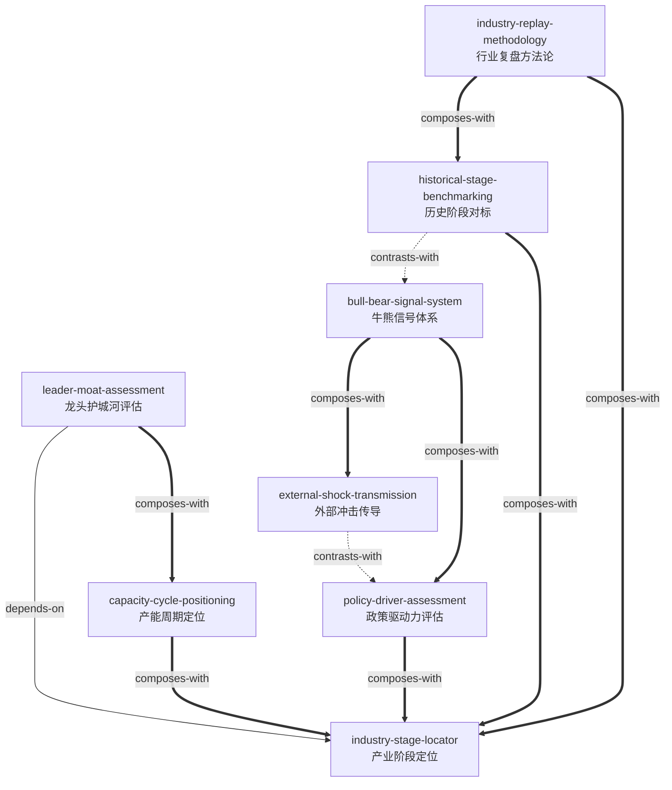

# 《致敬，我们的市场》 — Skill Index

> 本书蒸馏采用双轨并行，共产出 **8** 个分析 skills + **22** 个行业案例档案。
> 处理时间: 2026-06-14 ~ 2026-06-15
>
> 📂 本 skill 层属于本工程（Industry-analysis）的 [historical-review 历史对照层](../)（原独立工程 StockReview，2026-10-18 收编）。配套的 [案例数据层](../行业案例档案库/)（22个行业完整档案）和 [统一框架文档](../行业生命周期全景框架_蒸馏笔记.md) 提供具体数据支撑。
>
> **触发边界（2026-10 起）**：8 个技能的 description 首段均标注【历史对照层】与对应顶层技能，避免与当期分析技能混淆；本层不进入 orchestrator 自动调用链。

## 关于这本书

- **书名**: 致敬，我们的市场——中国股债、行业全景复盘
- **作者**: 上海申银万国证券研究所有限公司（主编），王胜（策略首席）、黄子函（高级分析师）统筹，百余位行业分析师参与
- **出版年**: 2021
- **一句话主旨**: 以"基本面趋势 + 流动性/估值 + 风险偏好 + 外部冲击 + 政策"五力模型，系统性复盘中国资本市场 2003--2020 年的运行规律，揭示不同产业生命周期阶段的股价驱动逻辑和牛熊转换的触发机制。
- **整书理解**: 见 [行业生命周期全景框架_蒸馏笔记](../行业生命周期全景框架_蒸馏笔记.md) 第零章

---

## Skill 列表 (按主题分组)

### 产业分析基础

- [`industry-stage-locator`](./industry-stage-locator/SKILL.md) -- 用渗透率、增速、政策信号判断行业处于生命周期的哪个阶段，并给出该阶段的核心观测指标和典型风险。
- [`capacity-cycle-positioning`](./capacity-cycle-positioning/SKILL.md) -- 用产能四阶段模型（扩张→过剩→出清→再平衡）定位行业供需格局，配合"需求决定方向、供给决定弹性"法则判断盈利拐点。
- [`leader-moat-assessment`](./leader-moat-assessment/SKILL.md) -- 从行业集中度趋势、四类护城河（品牌/成本/技术/网络）到估值溢价合理性，系统性评估龙头公司的可投资性。

### 市场环境判断

- [`bull-bear-signal-system`](./bull-bear-signal-system/SKILL.md) -- 区分水牛 vs 业绩牛、识别戴维斯双击/双杀环境、判断市场对冲击是否"脱敏"的结构化信号体系。
- [`external-shock-transmission`](./external-shock-transmission/SKILL.md) -- 三层管道分析框架（商业周期→分子端 / 美元周期→分母端 / 政治周期→风险偏好）配合 A 股反身性机制，判断外部冲击是否会演变为系统性危机。
- [`policy-driver-assessment`](./policy-driver-assessment/SKILL.md) -- "政策与经济交谊舞"节奏判断 + "必要条件+充分条件"双层投资时钟 + 三面共振的行情级别判断方法。

### 历史对标与复盘

- [`historical-stage-benchmarking`](./historical-stage-benchmarking/SKILL.md) -- "像→不像→像"三阶段认知校准模型：先从表面找相似，再识别关键差异，最后在驱动力层面回归共性规律，避免"这次完全一样"和"这次完全不一样"两个极端。
- [`industry-replay-methodology`](./industry-replay-methodology/SKILL.md) -- 将申万宏源机构级研究方法论降维为个人可执行的六步复盘 SOP（事件日历→信号日志→驱动力验证→跨期类比→关键假设表），是统筹其他所有 skill 的"元能力"。

---

## 引用图

图例:
- `-->`  depends-on（前置依赖）
- `-.->` contrasts-with（可选方案，看情境选一）
- `===>` composes-with（经常配合使用）

---

## 推荐学习顺序

从依赖图的叶子节点开始，逐步向上。分四个层次：

### 1. 入门 -- 基础框架（无前置依赖，最先学习）

- **industry-stage-locator** -- 全书最核心的锚点框架。先建立"行业处于什么阶段、该关注什么指标"的底层认知，后续所有 skill 都以阶段定位为参照系。

### 2. 进阶 -- 中观分析（配合基础框架使用）

- **capacity-cycle-positioning** -- 在理解生命周期的基础上，深入产能周期的供需节奏。与阶段定位互补：周期定位回答"行业现在的呼吸节奏"，生命周期回答"行业是什么年纪"。
- **historical-stage-benchmarking** -- 掌握"像→不像→像"的历史对标方法。在定位当前阶段后，去历史中寻找处于类似阶段的行业作为参照系和"可能性边界"。

### 3. 进阶 -- 宏观与市场判断（交叉使用，构建完整视角）

- **bull-bear-signal-system** -- 学习区分水牛与业绩牛、戴维斯双击/双杀、脱敏检测。这套信号体系可以独立使用，也与外部冲击传导和政策评估配合形成"驱动力+信号"的双角度验证。
- **policy-driver-assessment** -- 掌握"交谊舞"节奏判断和三面共振框架。中国市场政策权重极高，政策分析是产业阶段定位和牛熊判断不可或缺的维度。
- **external-shock-transmission** -- 理解海外因素的三层传导管道和 A 股反身性机制。与政策评估形成"外因 vs 内因"的双重视角——重大外部冲击往往触发国内政策响应，两者经常需要结合。

### 4. 综合 -- 投资决策与元能力（在前三层基础上整合）

- **leader-moat-assessment** -- **依赖 industry-stage-locator**，必须先能定位行业阶段才能评估龙头护城河。同时与产能周期定位配合，在产能出清期寻找受益最大的龙头。这是从"分析"到"决策"的最后一步。
- **industry-replay-methodology** -- 全书的方法论"元能力"。掌握完整复盘 SOP 后，你可以自己对新行业执行从事件日历到关键假设表的全流程分析，不再依赖他人现成的复盘结论。建议在所有其他 skill 学习完毕后阅读，此时各 skill 的框架将成为你执行复盘流程时的分析工具库。

---

## test-prompts

所有 skill 均带有 `test-prompts.json`，可用于自动化测试和 skill 进化。

---

## 审计轨迹

- 候选单元池: [candidates/](./candidates/)
- 被淘汰的候选 (含原因): 见 [verified.md](./verified/verified.md)
- BOOK_OVERVIEW: 未单独合并（核心内容见《行业生命周期全景框架_蒸馏笔记》第零章）
