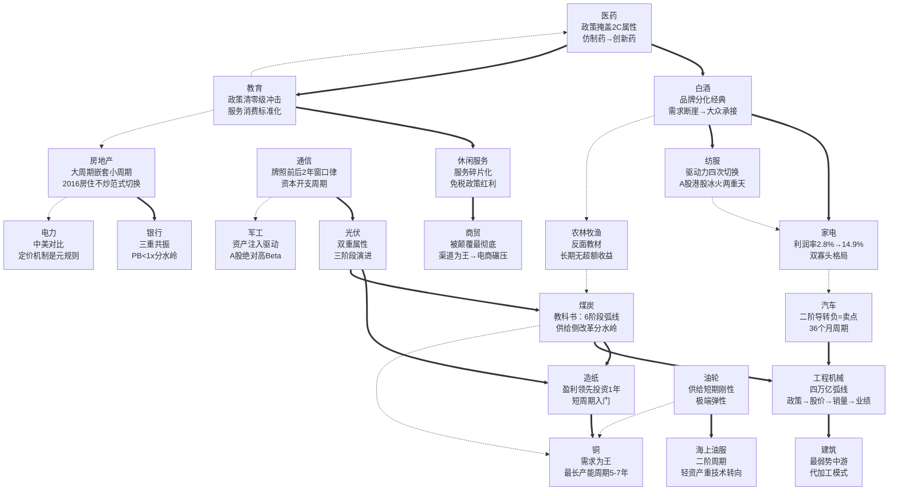

# 行业案例关联关系图

> 此文档定义所有案例之间的依赖/配合/对比关系，帮助读者在查看一个案例时知道应该同时参考哪些其他案例。

---

## 关系类型说明

| 关系 | 符号 | 含义 |
|------|------|------|
| **composes-with** | `==>` | 经常配合使用。两个案例互补视角，一起看能获得更完整理解 |
| **contrasts-with** | `-.->` | 可选方案/对比。两个案例在同一维度上形成鲜明对比 |
| **depends-on** | `-->` | 前置依赖。理解B案例需要先理解A案例的基础概念 |

---

## 全文关系图



---

## 推荐阅读路径

### 路径1：入门——先理解"周期"

```
造纸（短周期入门）
  └─> 煤炭（完整6阶段教科书）
       ├─> 铜（理解"需求为王"）
       ├─> 油轮（理解"供给刚性弹性"）
       └─> 工程机械（理解"政策传导链"）
```

### 路径2：入门——先理解"品牌"

```
白酒（品牌分化的经典）
  ├─> 家电（制造业如何穿越周期）
  ├─> 纺服（品牌如何被颠覆又如何复兴）
  └─> 汽车（周期属性最强的消费）
```

### 路径3：入门——先理解"技术迭代"

```
通信（牌照窗口律）
  ├─> 光伏（技术+周期双重属性）
  ├─> 医药（政策+技术的叠加）
  └─> 军工（资产注入→业绩驱动的转型）
```

### 路径4：风险教育——理解"什么时候应该回避"

```
农林牧渔（长期无超额收益）
  └─> 教育（政策可以一夜归零）
       ├─> 建筑（没定价权的中游没有投资价值）
       └─> 商贸（被颠覆的行业很难翻身）
```

---

## 单案例关联详情

### 煤炭
| 关联案例 | 关系 | 为什么 |
|----------|------|--------|
| 造纸 | composes-with | 造纸的"盈利领先投资1年"规律在煤炭同样成立；煤炭长周期(3-5年)、造纸短周期(2-3年)，并行对比可理解周期长度的影响 |
| 工程机械 | composes-with | 同为四万亿受益行业。四万亿对煤炭（价格驱动）和工程机械（销量驱动）的传导路径不同 |
| 铜 | contrasts-with | 铜是需求驱动（需求疲弱时价格绝不上涨），煤炭2016后是政策/供给驱动——对比理解两种周期驱动力 |
| 农林牧渔 | contrasts-with | 煤炭有清晰的可分析工业产能周期，农林牧渔的猪周期受生物因素（疫情/天气）更多扰动 |

### 白酒
| 关联案例 | 关系 | 为什么 |
|----------|------|--------|
| 家电 | composes-with | 同为"品牌力确立→龙头利润稳定增长"，白酒靠品牌稀缺、家电靠效率护城河——两条不同的穿越周期路径 |
| 纺服 | composes-with | 品牌分化的两条路径：白酒"掉队不可逆袭" vs 纺服"品牌可能复兴（李宁）" |
| 医药 | composes-with | "从普涨到分化"的范式切换在两个行业都是核心叙事 |

### 通信
| 关联案例 | 关系 | 为什么 |
|----------|------|--------|
| 光伏 | composes-with | 同为技术迭代型。光伏有产能周期（制造属性），通信没有——对比理解"纯技术迭代"和"技术+周期"的差异 |
| 军工 | contrasts-with | 通信有清晰的基本面驱动（资本开支→设备商盈利），军工历史上以资产注入预期驱动——两种截然不同的行业驱动逻辑 |
| 医药 | composes-with | 同为"技术换代+政策催化"的双重属性行业 |

### 教育
| 关联案例 | 关系 | 为什么 |
|----------|------|--------|
| 医药 | composes-with | 同为全书政策敏感度最高的消费行业。医药政策"改变格局"，教育政策"改变边界" |
| 农林牧渔 | composes-with | 同为"高风险行业需要特别审慎"的提醒 |
| 房地产 | contrasts-with | 同为政策永久性改变行业本质（房住不炒 vs 双减），但房地产是"属性弱化"、教育是"部分清零" |

---

## 跨类型类比索引

以下类比跨越了生命周期模式，但在底层逻辑上有深刻的一致性：

| 类比 | 周期/技术案例 | 品牌消费案例 | 共享规律 |
|------|-------------|-------------|---------|
| **产能过剩出清 = 品牌泡沫崩溃** | 煤炭2012-2015 | 白酒2012-2014 | 过剩→出清→龙头重生 |
| **政策底=最佳买点** | 光伏2018"531" | 汽车2008购置税 | 政策冲击低点是布局窗口 |
| **供给刚性=品牌稀缺** | 油轮极端弹性 | 茅台不可替代 | 供给/品牌越稀缺，弹性越大 |
| **二阶导转负** | 汽车销量增速减速 | 白酒批价涨速放缓 | 二阶导是比一阶导更敏感的拐点信号 |
| **轻资产=弱周期** | 通信设备(<1年投产) | 教育（预收费模式） | 资产越轻，周期波动越小但政策风险越大 |
| **重资产=强周期** | 铜矿(5-7年投产) | 养猪(生物周期) | 资产越重，周期越长但可预测性越高 |

---

## 分析技能层 → 案例数据层 映射

> 此表将 [分析技能层](../分析技能层/) 中的每个 skill 映射到最相关的案例档案。使用 skill 时，同时打开对应案例获取详细数据。

| 分析 Skill | 最相关案例 | 用途 |
|-----------|-----------|------|
| **industry-stage-locator** | 光伏、通信、工程机械 | 验证三阶段框架在不同行业的适用方式 |
| **capacity-cycle-positioning** | 煤炭、造纸、铜、油轮 | 对比不同产能周期长度（2-3y/3-5y/5-7y）的差异 |
| **leader-moat-assessment** | 白酒、家电、通信 | 品牌护城河 vs 效率护城河 vs 技术护城河的验证 |
| **bull-bear-signal-system** | 汽车、白酒、光伏 | 戴维斯双击/双杀的触发条件验证 |
| **external-shock-transmission** | 光伏、油轮、通信 | 外部冲击的传导路径与"脱敏"过程 |
| **policy-driver-assessment** | 教育、煤炭、房地产 | 政策对行业的不同影响程度（清零/改命/熨平） |
| **historical-stage-benchmarking** | 全部案例 + 行业对比示范 | "像→不像→像"的全行业数据支撑 |
| **industry-replay-methodology** | 行业对比示范/ | 复盘SOP的完整实例 |

## 推荐学习路径

```
第一层：方法论
    分析技能层/industry-stage-locator
        ↓
    分析技能层/capacity-cycle-positioning
        ↓
    分析技能层/historical-stage-benchmarking
        ↓
第二层：案例验证
    打开对应的案例档案（如煤炭/白酒/通信）
    用案例中的实际数据检验方法论
        ↓
第三层：综合应用
    行业对比示范/ 中的完整演示
    用对比模板自己分析一个行业

第四层：元能力
    分析技能层/industry-replay-methodology
    （掌握后可对新行业独立执行完整复盘）
```

> **使用建议**：在查看任何一个案例档案时，先查阅此文档的"单案例关联详情"，然后打开推荐的 composes-with 案例一起阅读。contrasts-with 案例用于检验你对规律的理解是否完整。对于系统性学习，按推荐学习路径先学方法论再看案例。